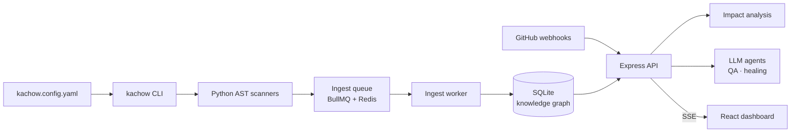

# KA-CHOW

> A living knowledge graph of your engineering system, with cross-repo API impact analysis at PR time.

Built at a hackathon. KA-CHOW scans repositories, maps services and their dependencies into a graph, scores service health, and answers one question before you merge: **who breaks if this API changes?**

## Why

A deprecated endpoint with seven silent dependents is invisible in a single-repo PR. KA-CHOW ingests code, API definitions and git history across repos so the blast radius is visible at review time.

## Architecture



## Features

- Repo scanning with Python AST scanners (service and dependency extraction)
- Knowledge graph of services and dependencies, with health scores
- Impact analysis for API changes across repos
- GitHub webhook handling and live updates over SSE
- Background ingestion queue (BullMQ + Redis)
- LLM-assisted agents for QA, healing suggestions and notifications

## Architecture

pnpm + Turborepo monorepo:

| Package | Role |
|---|---|
| `packages/cli` | `kachow` CLI (Commander) and `kachow.config.yaml` reader |
| `packages/server` | Express + TypeScript API, SQLite (better-sqlite3), BullMQ workers, SSE |
| `packages/python-agents` | AST scanner and dependency analyzer |
| `packages/frontend` | React dashboard |

## Getting started

Requires Node 20+, pnpm 9, Redis and Python 3.

```bash
pnpm install
cp .env.example .env          # fill in values
# edit kachow.config.yaml to list the repos to monitor
pnpm --filter @kachow/server dev
```

Run tests: `pnpm --filter @kachow/server test`

## Tech

TypeScript, Express, SQLite, BullMQ, Redis, Zod, Octokit, OpenAI, Python, Vitest, Turborepo.
